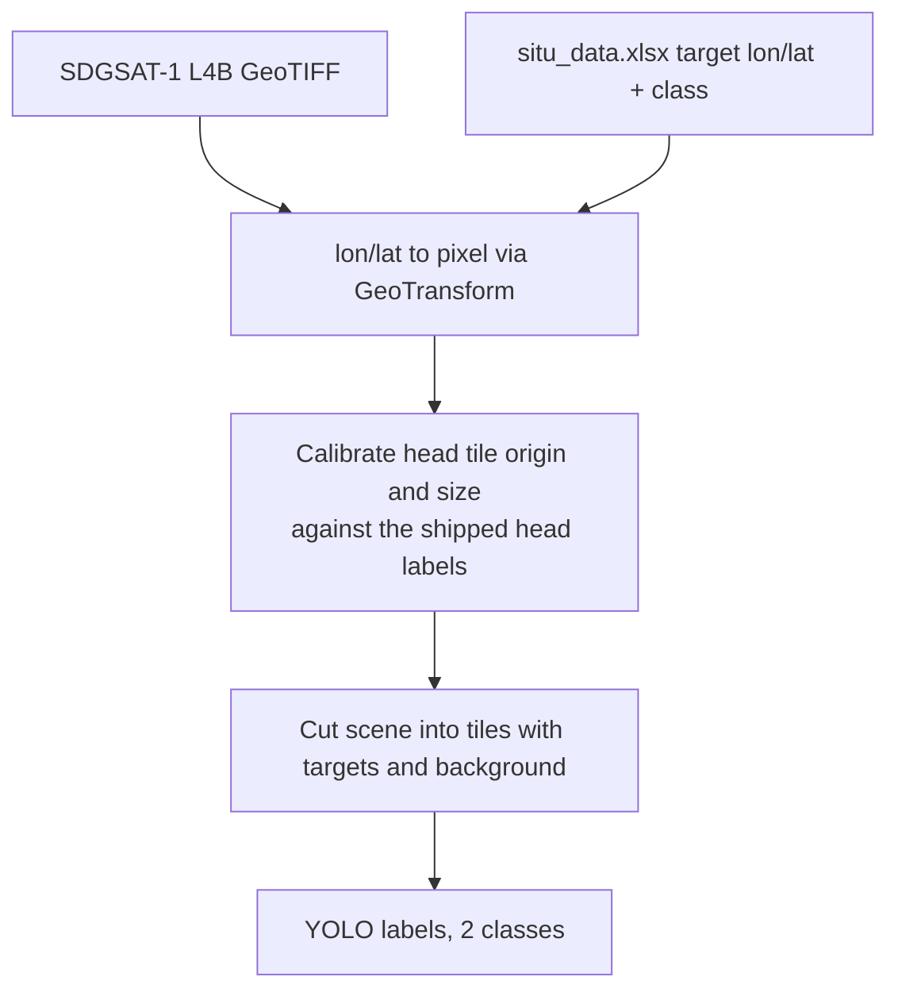

# TIFAD.v1 — Satellite Thermal Aircraft Stream (Objective 2, satellite variant)

Status: **dataset downloaded and audited; not yet trainable.** The public TIFAD.v1
release does not contain the satellite scenes its labels refer to. Those scenes
must be ordered separately from the SDGSAT-1 Open Science Program. This folder
holds the audit, the scene request list, and the tooling to finish the job.

## What TIFAD.v1 actually contains

Source: [Figshare 10.6084/m9.figshare.26413852.v2](https://doi.org/10.6084/m9.figshare.26413852.v2),
CC BY 4.0, 27.7 MB, accompanying Li et al., *Thermal Sentinel*, Remote Sensing of
Environment, 2025.

| File | Contents |
|---|---|
| `TIFAD.v1_images.7z` | 22,255 TIFF chips, ~20x20 px, one crop per target |
| `TIFAD.v1_label.7z` | 12,944 YOLO `.txt` files, one per scene tile |
| `TIFAD.v1_civi_aircraft_Flightradar.zip` | 1,651 CSVs of per-target radiometry |
| `TIFAD.v1_situ data.xlsx` | Per-target table: filename, class, longitude, latitude, and DN / radiance / brightness temperature / SCR for all three thermal bands |

Verified properties:

- **Two classes**, not one: `0` aircraft (21,003) and `1` contrail aircraft (1,252).
- Labels are already in YOLO format, `class x_center y_center width height`,
  normalised. Median box is 0.0155 x 0.0165 of the parent tile.
- Aircraft appear as **dark** points, since cruising skin is colder than the
  surface below. Detectors tuned for bright infrared targets will not transfer.
- Chips are ~20x20 px crops centred on each target, at 30 m resolution.

## The blocker

The labels are indexed by scene tile (`..._L4B_head_0.txt`), and their coordinates
are normalised to that tile. **The tiles and the scenes are not in the release.**
The correspondence is exact and was verified for all 12,944 tiles: the number of
label lines per tile equals the number of released chips for that tile, totalling
22,255 in both cases. So every released image is a crop of a target whose parent
image is missing.

Training on the chips alone would be meaningless: every image would contain
exactly one centred aircraft and there would be no background-only samples, so a
detector would score near-perfect while learning nothing useful.

## Getting the scenes

Every label filename encodes its scene, for example
`KX10_TIS_20230305_E12.74_N42.04_202300055197_L4B_head_0`, giving satellite, sensor
(TIS = thermal infrared), date, centre coordinates, scene/task id and product
level (L4B). `scripts/build_request_list.py` turns those filenames into an order
list.

The labelled corpus spans **3,215 distinct scenes** (2,342 from 2023, 873 from
2024). A new SDGSAT-1 account carries a quota of **20 scenes**, so the list is
sorted by target density; the top 20 scenes alone contain 1,526 annotated
aircraft, which is already comparable to the 1,400 boxes in the cleaned
IRdata-4465 training split.

| Scenes requested | Targets obtained | Share of TIFAD |
|---|---|---|
| 20 (default quota) | 1,526 | 6.9% |
| 100 | 5,061 | 22.7% |
| 500 | 13,102 | 58.9% |
| 3,215 (all) | 22,255 | 100% |

Procedure:

1. Register at [sdgsat.ac.cn](https://www.sdgsat.ac.cn/). Verification takes a few
   days. If the 20-image quota does not appear, email `sdgsat1@cbas.ac.cn`.
2. For a larger allocation, submit a research proposal through the portal's
   Proposal Submission form. Requesting the full 3,215 scenes needs this step.
3. Under Data Access, search per scene using `outputs/sdgsat1_top20_request.csv`:
   draw a small area of interest around the listed latitude/longitude, set the
   date to the listed acquisition date, sensor **TIS**, product grade **L4B**.
4. Download the matching `ProductID.zip`, whose id must equal the `scene_id`
   column. Unzip into `TIFAD/scenes/`.

Licence terms to respect: SDGSAT-1 data is for non-commercial scientific research,
must not be redistributed, and publications must acknowledge that "the SDGSAT-1
data are kindly provided by CBAS".

## Once the scenes arrive

The scenes are ortho-rectified georeferenced GeoTIFFs, and `situ data.xlsx` gives
every target's longitude and latitude. That allows labels to be rebuilt directly
by geographic lookup, which sidesteps the unknown `head` tiling scheme entirely:



The shipped `head` labels then serve as a cross-check: for any tile with two or
more targets, the tile origin and size can be solved from the geographic pixel
positions and the normalised label coordinates, confirming the reconstruction is
correct before any training.

This step needs a geospatial reader that is not yet installed:

```bash
../.venv/bin/pip install rasterio
```

The converter is deliberately not written yet: its correctness depends on the real
GeoTransform and tile convention, which cannot be verified without at least one
actual scene. Supply one scene and it can be written and validated immediately.

## Layout

```
TIFAD/
  raw/                     # the four downloaded archives (md5-verified)
  raw/extracted/           # chips, labels, flightradar CSVs
  scripts/build_request_list.py
  outputs/sdgsat1_scene_request_list.csv   # all 3,215 scenes, ranked
  outputs/sdgsat1_top20_request.csv        # what to order first
  outputs/figures/tifad_chips.png          # what the release really looks like
  scenes/                  # put downloaded L4B products here
```
